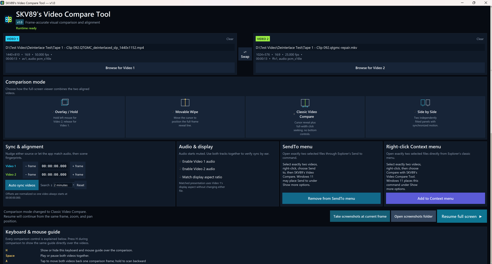
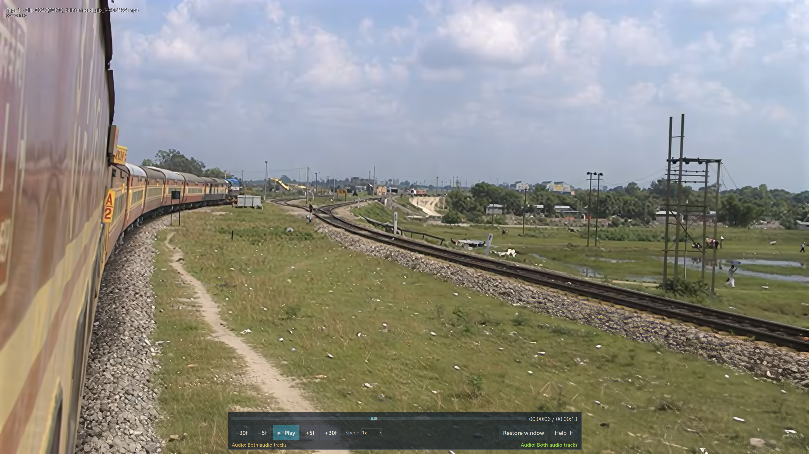
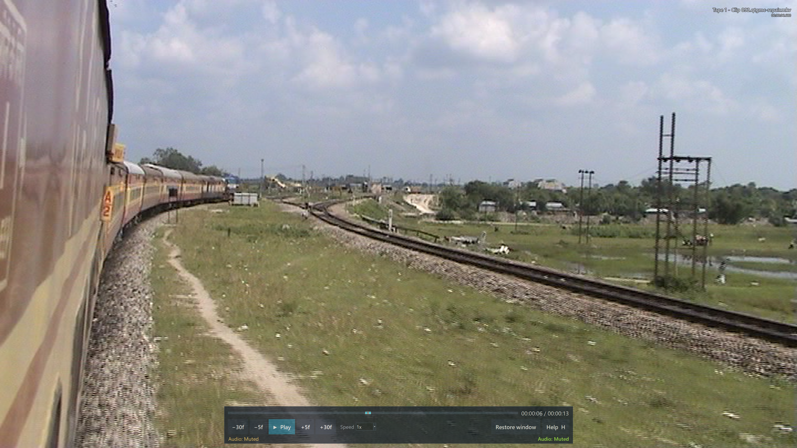
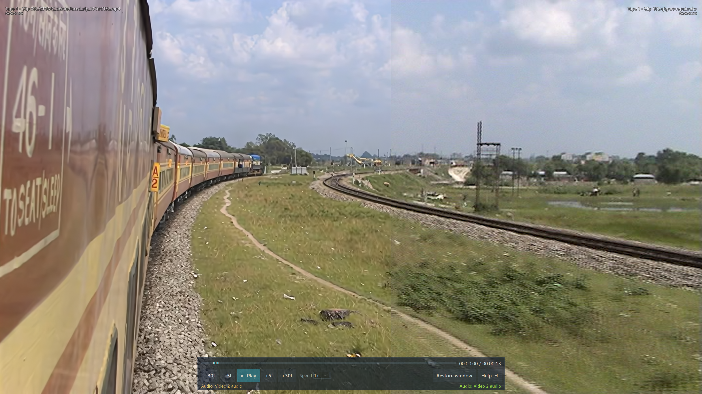
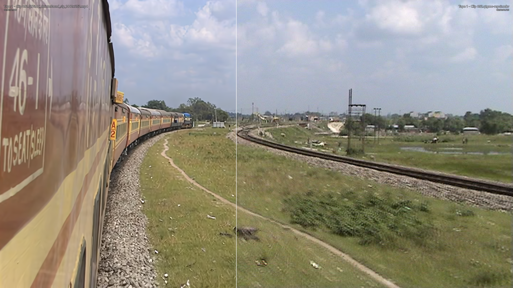
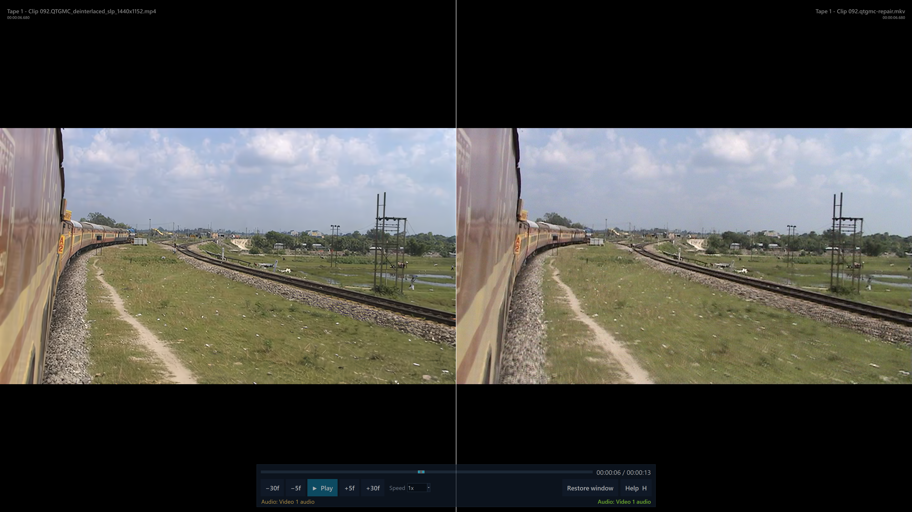
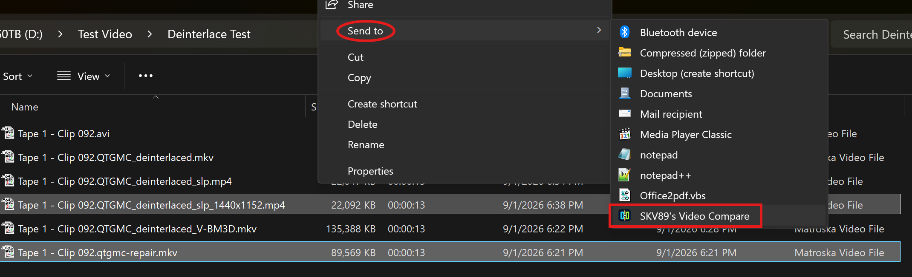

# SKV89's Video Compare Tool v1.0

**A portable Windows viewer for synchronized, frame-level A/B comparison of two videos.**

[Download the v1.0 portable ZIP](https://github.com/skv89/SKV89s-Video-Compare-Tool/releases/download/v1.0.0/SKV89s-Video-Compare-Tool-v1.0-Windows-x64-Portable.zip)



SKV89's Video Compare Tool keeps two sources on one common timeline and gives you four ways to inspect the difference. It is especially useful when two encodes look nearly identical until you hold on a face, follow a moving edge, or watch texture stability over several frames.

The v1.0 download is a portable Windows x64 package. Extract the entire ZIP and keep its files together; FFmpeg, FFprobe, MPV, licenses, and provenance notices are included.

## Four comparison modes

### 1. Overlay / Hold

Video 1 is visible normally. Hold the left mouse button to display Video 2, then release it to return instantly to Video 1. This is the quickest way to blink between aligned frames and notice subtle changes in facial texture, ringing, compression, edges, or grain. Press `Tab` to change which source remains visible.

| Video 1 | Video 2 while holding the left button |
|---|---|
|  |  |

### 2. Movable Wipe

Move the pointer horizontally and the thin reveal line follows it smoothly—no button needs to be held. Video 1 is shown on one side and Video 2 on the other, so the same face, edge, or object can be compared at one registered boundary. The line pauses while the pointer is over the bottom transport panel so timeline controls remain easy to use. Press `Tab` to swap sides.



### 3. Classic Video Compare

This mode follows the classic [`pixop/video-compare`](https://github.com/pixop/video-compare) interaction: the reveal line tracks the pointer, the bottom transport panel stays hidden, and the entire screen width acts as the seekbar. Click 23% across the screen to seek to 23% of the common timeline; click the far left for the beginning or the far right for the end. The lower-right time readout previews the common-timeline position under the pointer before you click. Press `Tab` to swap sides.



### 4. Side by Side

Both complete videos are fitted into separate panels and move together on the synchronized timeline. This is useful when you want to judge the whole presentation rather than one split boundary. Press `Tab` to swap the left and right panels.



Every mode shows each source filename with its current decoded source-frame timestamp. Mouse-wheel zoom, middle-click fit/reset, and right-button drag pan both sources together, keeping the inspected detail aligned.

## A practical Topaz Video AI comparison workflow

There is no universally best model or setting for every source. The useful question is: **which result is best for this particular video, across both still details and motion?**

Export the same source range with Iris, Rhea, Proteus, Artemis, or Gaia, then load any two outputs. Keep the source interval, crop, frame rate, and presentation consistent. Start with Overlay / Hold for immediate whole-frame switching, move to Movable Wipe or Classic mode to place a boundary through a face or high-contrast edge, and use Side by Side to judge the complete image in motion.

The same process works for a second pass after SLP. Compare the first-pass result with alternate second-pass outputs using different values for dehalo, Improve Detail, Recover Detail, denoise, Fix Compression, or related controls. Change one group of settings at a time and keep descriptive filenames so the winning result is reproducible.

For “dirty face” cleanup, inspect more than one paused close-up and more than one lighting condition. Look for:

- fewer blocks, mosquito noise, halos, ringing, and blotchy skin patches;
- stable eyes, lips, hair, and facial boundaries instead of invented or crawling detail;
- reduced compression without plastic skin or erased natural texture;
- consistent detail through motion, cuts, and expression changes;
- less shimmer, ghosting, smearing, or texture that changes character from frame to frame.

Use `1` for fit-to-window and `2` for 1:1 source pixels. A still frame can make an aggressive setting look impressive while hiding temporal instability, so always replay the difficult scene before deciding. Matching display aspect ratio can normalize presentation without modifying either file, and the app remembers that choice for the next session.

## Keep two videos synchronized

Files can begin at different moments, have leading slates, or drift because of edit and timing differences. The setup window provides both automatic and manual alignment.

**Auto sync videos** first correlates low-rate audio fingerprints. If usable audio is unavailable or that result is inconclusive, it falls back to reduced scene fingerprints. A low-confidence match is reported without changing the offsets. Always spot-check an automatic result at several cuts, especially with silent, repetitive, or heavily edited material.

For manual correction:

| Key | Action |
|---|---|
| `8` | Move Video 1 backward by one of its own frames |
| `9` | Move Video 1 forward by one of its own frames |
| `5` | Move Video 2 backward by one of its own frames |
| `6` | Move Video 2 forward by one of its own frames |

Those four keys also support graduated scanning while held: 0.5x immediately, 1x after 1.5 seconds, 2x after 3 seconds, and 4x after 5 seconds. Top-row and Numpad digits are supported. `A` and `D` move both sources by one common comparison frame when tapped, or scan backward/forward when held. Enable both audio tracks when an audible phase check will help.

## Paired frame screenshots

Press `P` or Print Screen during comparison to save **two clean JPG files**—one decoded source frame from each video, without the comparison line or interface. The app automatically creates a `screenshots` subfolder beside the executable.

Both filenames begin with the same timestamp, followed by the original video filename, so each pair sorts together in Explorer. After both JPGs are validated, **Screenshots saved** appears at the center of the comparison for half a second.

The setup window also has **Take screenshots at current frame** and **Open screenshots folder** buttons. If you returned from comparison, the button captures the preserved Resume position. `Q` is different: it saves one PNG of the complete comparison view under `Pictures\SKV89 Video Compare Captures`.

## Windows Explorer integration—highly recommended

For the most convenient workflow, install one or both Explorer commands from the setup screen. They let you select two outputs where they already live and open them directly, avoiding repeated browsing inside the app.



### SendTo menu

1. Select exactly two video files in Explorer.
2. Right-click the selection and open **Send to**.
3. Choose **SKV89's Video Compare**.

Use **Add to SendTo menu** once in the app. The button changes to **Remove from SendTo menu** after installation.

### Right-click Context menu

1. Select exactly two video files in Explorer.
2. Right-click and choose **Compare with SKV89's Video Compare Tool**.
3. On Windows 11, open **Show more options** if the classic command is not shown immediately.

Use **Add to Context menu** once in the app. Explorer can invoke classic verbs once per selected file; the tool safely gathers the two launches into one comparison.

Both integrations are per-user and do not require administrator rights. They point to the current executable, so if you move the portable folder later, remove and add each integration again. The app rejects any selection count other than exactly two and validates the inputs with FFprobe rather than trusting file extensions alone.

## Essential controls

| Input | What it does |
|---|---|
| `Space` | Play or pause both videos |
| Timeline click / drag | Jump to a location or scrub through scenes |
| Left / Right | Seek backward / forward 1 second |
| Up / Down | Seek forward / backward 15 seconds |
| Page Up / Page Down | Seek forward / backward 10 minutes |
| Home / End | Go to the first / last valid common frame |
| `W` / `S` | Jump forward / backward by 10% of the shorter source |
| `1` / `2` | Fit to window / show 1:1 source pixels |
| Mouse wheel | Zoom both videos together |
| Middle click | Fit both videos and reset pan |
| Right-button drag | Pan both zoomed videos together |
| Left Shift | Cycle muted → Video 1 → Video 2 → both → muted |
| `H` | Show or hide the complete on-screen keyboard and mouse guide; scroll it with the wheel |
| `Backspace` or `M` | Return to the maximized setup window while preserving time, zoom, pan, mode-ready resume state, and playback state |
| `4` | Leave borderless full screen for a maximized, adjustable comparison window |
| `F11` | Toggle borderless full screen and the maximized adjustable comparison window |
| `Esc` | Exit the application completely |

Starting a new comparison plays automatically. Returning with `Backspace` or `M` changes the setup button to **Resume full screen**. Changing mode, audio selections, or alignment does not discard the saved timeline, zoom, or pan; Resume continues from the preserved view, clamped only if a new alignment shortens the common range.

## Download and integrity

1. Download `SKV89s-Video-Compare-Tool-v1.0-Windows-x64-Portable.zip` from the [v1.0 release](https://github.com/skv89/SKV89s-Video-Compare-Tool/releases/tag/v1.0.0).
2. Verify the SHA-256 checksum if desired:

   ```text
   5F04E14D9F116B65D4671CBDDC8776E25AAEA94798BF536FABF108B4BBE55F68
   ```

3. Extract the complete ZIP to a normal writable folder.
4. Run `SKV89's Video Compare Tool.exe` and keep the bundled `tools`, `licenses`, README, notices, and manifest beside it.

The executable is currently unsigned, so Windows may show a reputation warning. The archive includes exact dependency provenance and license notices. The release was tested on Windows 11 x64 with 107 unit tests, 34 packaged playback checks, and 69 physical mouse-and-keyboard checks; the complete packaged and physical suites were repeated from a fresh extraction of the final ZIP.

This repository is intentionally a source-free release and documentation page. Its public branch and tag contain only documentation and screenshots; the release asset contains only the portable application package. Topaz, Topaz Video AI, Iris, Rhea, Proteus, Artemis, and Gaia are names associated with their respective owner. This project is independent and is not affiliated with or endorsed by Topaz Labs.
