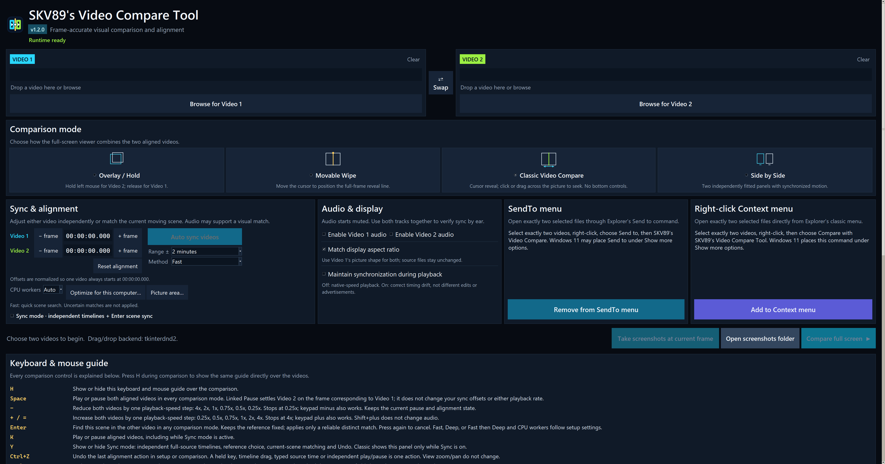
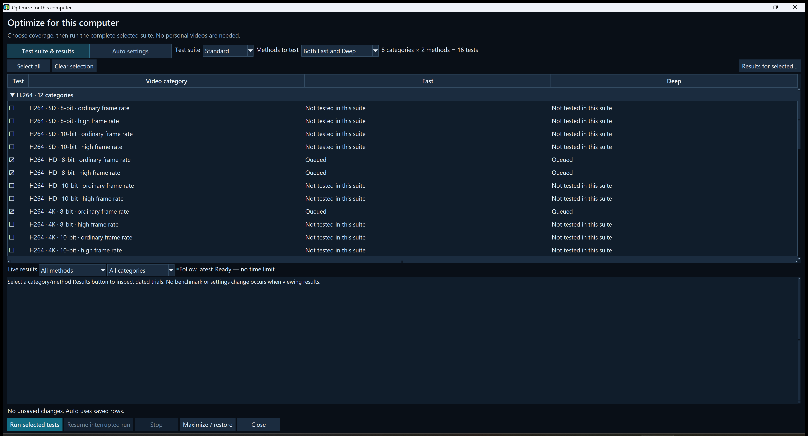
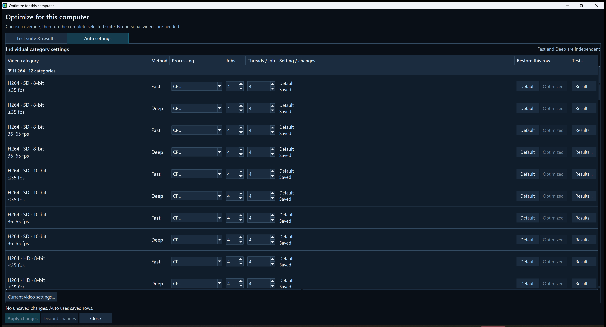

# SKV89's Video Compare Tool v1.2.0

A portable Windows app for comparing two videos, lining up corresponding scenes, and saving paired frames.

[Download v1.2.0 for Windows x64](https://github.com/skv89/SKV89s-Video-Compare-Tool/releases/download/v1.2.0/SKV89s-Video-Compare-Tool-v1.2.0-Windows-x64-Portable.zip) · [Changelog](https://github.com/skv89/SKV89s-Video-Compare-Tool/releases/tag/v1.2.0)

**Download size: 701.3 MB, including 477.2 MB of built-in benchmark videos used by Optimize for this computer.**

[Third-party sources and build records](https://github.com/skv89/SKV89s-Video-Compare-Tool/blob/v1.2.0/third-party/v1.2.0/README.md) (for developers; not needed to run).

## New in v1.2.0

Classic mode now supports holding the left mouse button and dragging left/right to scan both videos together. This release also adds per-computer search optimization, optional NVIDIA-assisted scene discovery and picture-area matching since v1.1.4. The download remains a multi-file portable folder: extract once and run the EXE from that folder.

## Faster to open, smoother to use

Compared with the original v1.0 release, the current app opens much faster, with smoother reveal-line movement and zoom-aware panning. Adaptive interaction updates slow down when the cursor is stationary or outside the comparison, reducing unnecessary CPU activity and idle overhead.

Actual system-resource use depends on the videos, playback, and sync searches; this does not mean every search is faster or uses fewer resources.

## Start comparing

Extract the complete ZIP to a writable folder, run **SKV89's Video Compare Tool.exe**, and choose two videos. Classic Video Compare is selected on first launch. Choose another mode if you prefer, then start full-screen comparison. The app opens maximized and remembers your chosen mode. Keep the entire folder together, including `_internal`, `tools`, and `licenses`; no separate Python installation is needed.

For everyday use, **adding the SendTo or right-click command is highly recommended**. Select two files in Explorer and open them directly in the app.

## Four comparison modes

### 1. Overlay / Hold

See Video 1 normally; hold the left mouse button to see Video 2 and release to switch back. This makes subtle differences in faces, texture, edges, and grain easy to spot. Tab changes the persistent visible source.

| Video 1 | Video 2 while holding the left button |
| --- | --- |
|  |  |

### 2. Movable Wipe

Move the cursor horizontally to place a thin dividing line through the same face or detail in both videos. No mouse button is needed. The line stops following the cursor over the bottom controls so you can use the timeline comfortably. Tab swaps sides.

### 3. Classic Video Compare

The cursor controls the reveal line, with no bottom transport panel. Click anywhere across the picture to seek by that percentage of the comparison timeline—for example, 23% across means 23% through the video. **Hold the left mouse button and drag left/right to scan both aligned videos together, just like dragging the timeline.** Playback pauses while you drag and returns to its previous play/pause state when you release. The bottom-right timestamp previews the location under the cursor. This interaction is inspired by [pixop/video-compare](https://github.com/pixop/video-compare). Tab swaps sides.

### 4. Side by Side

Show both complete pictures in separate panels. Use this to compare overall presentation and motion. Tab swaps the panels.

Every mode shows filenames and decoded source-frame timestamps. Wheel to zoom, right-drag to pan, and middle-click to fit both pictures again.

## Align differently edited videos

Press **Enter** to find the current reference scene in the other video. Use **Y** to open Sync mode, choose which source stays fixed, and navigate either video independently with its own timeline, time entry, and frame controls. Space remains play/pause in every mode.

- **Fast:** a quicker matching attempt.
- **Deep:** a more thorough search and neighboring-frame verification for difficult pairs.
- **Fast then Deep if needed:** use Deep only when Fast cannot establish a reliable match.

The search range is centered on the other video's current position. Choose **±30 seconds, ±1, ±2, ±5, or ±10 minutes**, or **Whole video**. For example, ±2 minutes covers up to four minutes of footage, clipped at the file ends. A strong, unambiguous nearby match can finish early; uncertain cases continue through the selected range.

If an advertisement, extra scene, or different intro breaks alignment later, move to footage shared by both versions and press Enter again. The app does not automatically reconstruct all edits in an episode. Missing scenes and static or repeated footage may remain inconclusive; a failed search leaves the current alignment unchanged.

For manual adjustments, **8 / 9** move only Video 1 backward / forward, and **5 / 6** move only Video 2. Tap for one source frame; hold to scan progressively faster. **Ctrl+Z** undoes a sync action and **Ctrl+Y** redoes it.

### Optimize for this computer

Leave **CPU workers** on **Auto**, then open **Optimize for this computer…**. No personal videos are needed: the app uses licensed built-in moving-video samples and prepares additional workloads locally.

Choose **Standard** for eight common HD/4K categories, or **Extended** for all 36 H.264, HEVC and AV1 categories across SD/HD/4K, 8/10-bit and two frame-rate bands. **Both Fast and Deep** tests both methods automatically—16 cases for Standard, 72 for Extended. The tab you are viewing does not change the tests. You can also choose one method or select individual categories.

The selected suite runs to completion. There is no short overall time limit; larger suites can take hours. Each measurement appears in Live results as it finishes. **Results…** opens configuration summaries and individual runs, with timings, resource limits and explanations of failed checks. **Stop** preserves progress; **Resume interrupted run** continues a compatible interrupted queue.

The optimizer compares CPU job counts and decoder-thread counts separately, testing a total budget of up to **32 decoder threads** when supported by the processor, available work and memory. It confirms contenders with repeated complete searches and independent scenes, and tries alternatives or extra measurements when results need clarification. Results describe the best verified choices among those tested, not a guaranteed global optimum. Close other heavy applications for more representative measurements.

At completion, choose **Apply verified recommendations** or **Let me review first**. Review and edit settings in **Auto settings**, then click **Apply changes**. Proposed settings are not active until applied. Explicit Manual/Default choices are preserved when applying benchmark recommendations; unsaved changes remain clearly marked.

Every category has separate Fast and Deep rows. Type **Jobs** and **Threads / job** directly, or use the arrows. **Default** restores the built-in limits; **Optimized** restores the latest compatible measured recommendation. You can resize columns and collapse codec groups. Saved settings remain active until you apply edits.

Untuned Auto starts at **4 jobs × up to 4 decoder threads** on CPUs with 16 or more logical processors, **2 × 4** on 8–15, and smaller limits below eight. These are maximum software-thread budgets, not reserved cores. More jobs or threads are not always faster. A number selected in the main CPU-workers dropdown overrides category tuning and uses CPU-only search; select **Auto** to use the per-category settings.

### Optional NVIDIA-assisted search

On compatible NVIDIA hardware, supported H.264 and HEVC rows offer **GPU + CPU**. You can select it manually without benchmarking. CPU-only rows show a plain CPU field. AV1, interlaced sources and unsupported layouts use CPU in this search backend; playback hardware decoding is separate.

GPU decoding helps discover candidate scenes; the CPU still performs independent detailed verification. Per-frame GPU decode-status checks add error evidence, but cannot guarantee detection of every damaged file. Reported corruption or unresolved terminal decode status stops the search. A capability or infrastructure failure can retry on CPU. Automatic GPU recommendations require a measured complete-search improvement; there is no universal speedup. GPU benchmarking stops at 91°C or loss of required temperature telemetry.

Each video uses settings appropriate to its role. The chosen **Fixed** frame stays fixed: reference reading uses that video's CPU/evidence limit, while target scanning uses the searched video's CPU or GPU settings. A CPU-only reference does not disable a supported GPU target. **Current video settings…** explains the limits for both files; progress and the completed result report the actual route.

### Match videos with decorative side panels

Use **Picture area…** when one version includes static wallpaper or other decorative edge panels. **Auto** excludes panels from matching only when it finds strong supporting evidence; **Full frame** keeps them, and **Custom** lets you specify the picture rectangle. Ambiguous scenes retain the full picture. The selected area affects matching analysis only: displayed video, screenshots and source files stay unchanged. Cropped sampling uses CPU, while an eligible full-frame target can still use GPU scanning.

### Comparing motion fairly

Leave **Maintain synchronization during playback** off to avoid ongoing speed or seek corrections during playback. Turn it on when keeping the current alignment is more important; it may adjust Video 2's speed or seek it to correct drift. It does not detect advertisements or missing scenes. Linked pause settles the two sources to their corresponding frames under the current alignment.

Different source frame rates remain different. Your monitor's refresh rate and decoder performance can also affect visible motion.

## Compare Topaz models and second-pass settings

Export the same scene with Iris, Rhea, Proteus, Artemis, or Gaia, then compare two outputs directly. Keep the source interval and presentation consistent. Use Overlay to switch between faces, Wipe to inspect an edge or skin texture, and Side by Side to watch movement.

You can also compare an SLP result with second-pass variations in dehalo, Improve Detail, Recover Detail, denoise, Fix Compression, or related settings. For “dirty faces,” look for fewer blotchy patches and compression artifacts without plastic skin, lost texture, unstable eyes, or invented detail. Check several faces, lighting conditions, and moving scenes—not only one impressive still. There is no universally best model or setting for every source.

## Paired screenshots

Press **P** or **Print Screen** to save two clean JPGs, one current decoded frame from each video, in the app's `screenshots` folder. The folder is created automatically. Both names start with the same timestamp followed by the original filename, keeping pairs together when sorted. A centered **Screenshots saved** message confirms success for half a second.

The main window also offers **Take screenshots at current frame** and **Open screenshots folder**. After returning from comparison, capture uses the preserved Resume position. **Q** instead saves a PNG of the complete comparison view.

## Explorer integration—recommended

**SendTo:** click **Add to SendTo menu** once. In Explorer, select exactly two videos, right-click, and choose **Send to → SKV89's Video Compare**.

**Direct right-click:** click **Add to Context menu** once. Select two videos and choose **Compare with SKV89's Video Compare Tool**. On Windows 11, the classic command may be under **Show more options**.

Both are per-user and removable from the app. If you move the portable folder, remove and add the integrations again so they point to the new location. SendTo passes both paths together; the direct classic command briefly collects Explorer's separate file launches.

## Essential controls

| Input | Action |
| --- | --- |
| Left-button hold and drag (Classic) | Scan both aligned videos together; release to restore the previous playback state |
| Space | Play or pause both videos |
| Enter | Auto-sync the current reference scene |
| Y | Show or hide independent Sync controls |
| Ctrl+Z / Ctrl+Y | Undo / redo a sync adjustment |
| A / D | Step both videos backward / forward; hold to scan |
| Left / Right | Seek backward / forward 1 second |
| Up / Down | Seek forward / backward 15 seconds |
| 1 / 2 | Fit the picture / show 1:1 source pixels |
| P or Print Screen | Save the two clean JPG frames |
| − | Reduce playback speed by one step |
| + or = | Increase playback speed by one step; keypad −/+ also work |
| Left Shift | Tap by itself to cycle muted, Video 1, Video 2, or both audio tracks |
| H | Show or hide Help; use the wheel to scroll it |
| Backspace or M | Return to setup, preserving the comparison position and view |
| 4 / F11 | Restore an adjustable comparison window / toggle full screen |
| Esc | Exit the program |

**Resume full screen** preserves time, zoom, and pan when you change comparison mode or audio settings. See the in-app guide for every key and mouse action.

## Requirements and download

Windows x64, a writable portable folder, and enough decoding capacity for two videos at once. Download the portable ZIP from the [v1.2.0 release](https://github.com/skv89/SKV89s-Video-Compare-Tool/releases/tag/v1.2.0); the SHA-256 file lets you verify the download. The executable is unsigned, so Windows may display a reputation warning.

FFmpeg, FFprobe, mpv, NVIDIA support runtimes, licensed benchmark samples, and third-party notices are included. GPU acceleration is optional; CPU operation remains available. This software uses FFmpeg libraries under the LGPL and separate FFmpeg/mpv programs under the GPL; see the package’s THIRD_PARTY_NOTICES.md and licenses folder for component licenses and source information. Keep the full extracted folder together. The app does not modify or upload the source videos. Keep the portable folder writable for optimization data and captures.

This independent project is not affiliated with or endorsed by Topaz Labs. Topaz and its model names belong to their respective owner.

For upgrading and settings locations, see the README inside the download. Previous v1.1.4 CPU tuning files remain untouched; they are not imported into the new optimizer, so run Optimize again. Valid v1.2 suite history remains readable after an engine, runtime or hardware change, but only compatible results can supply active recommendations.

Third-party sources and build records — not needed to run the app

The portable package includes FFmpeg/FFprobe 9.0.2 and mpv 0.41.0. [Exact third-party source downloads and build records](https://github.com/skv89/SKV89s-Video-Compare-Tool/blob/v1.2.0/third-party/v1.2.0/README.md) are available for inspecting or rebuilding these dependencies. The sources are hosted by their upstream providers; no large source archive is included among the application downloads. These materials are not needed to run Video Compare.

