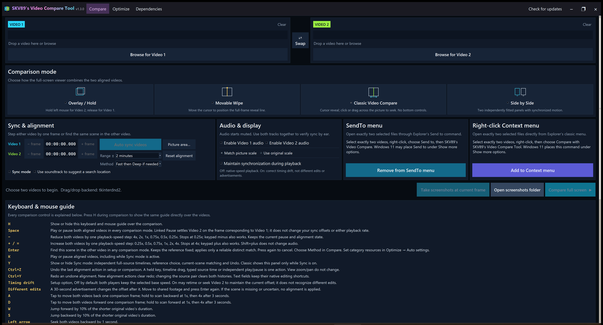
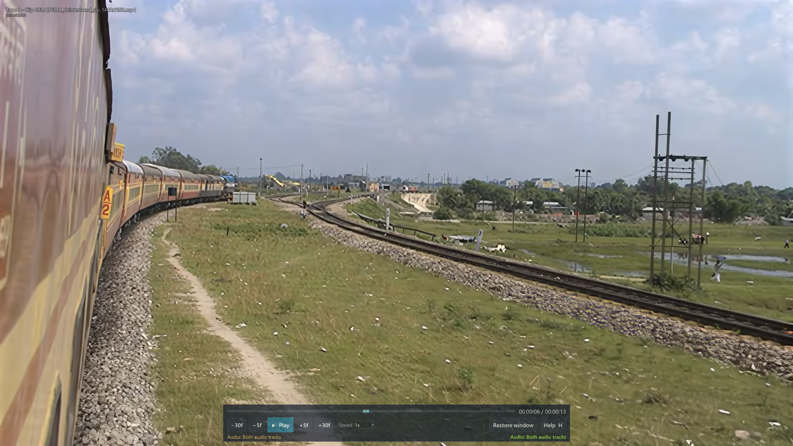
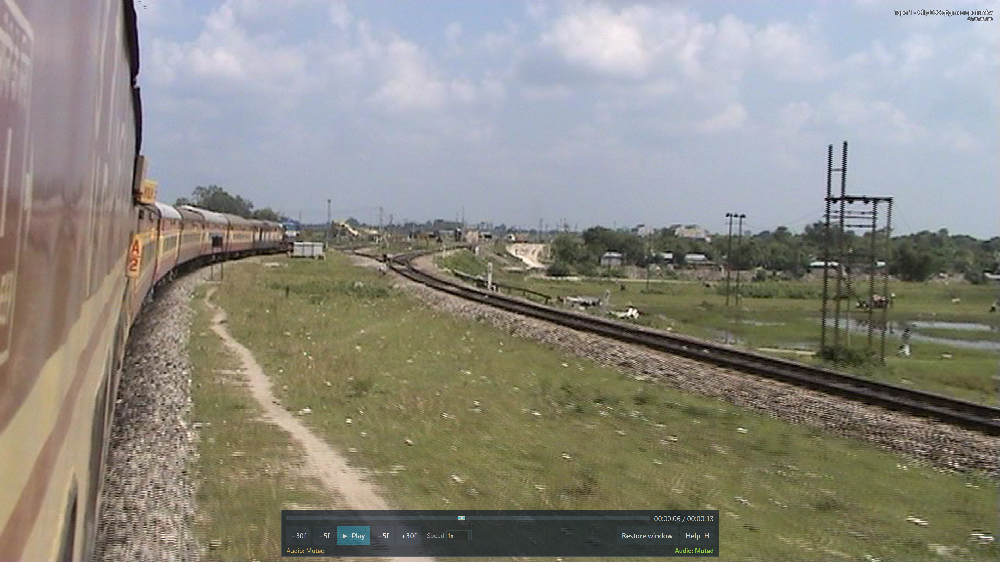
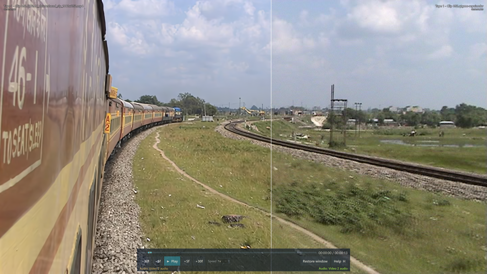
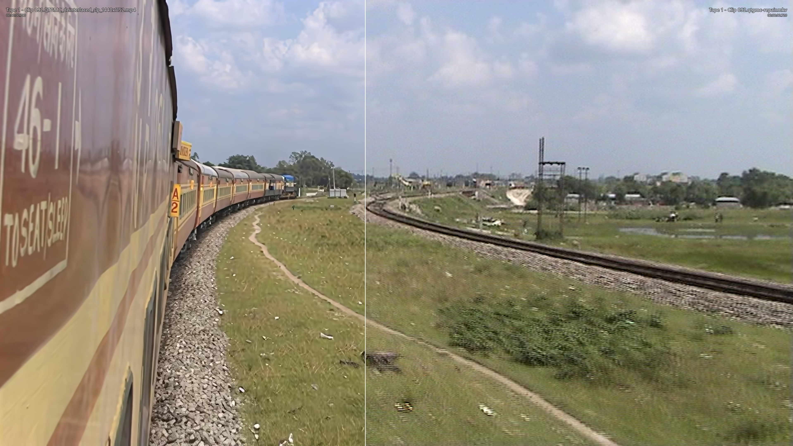
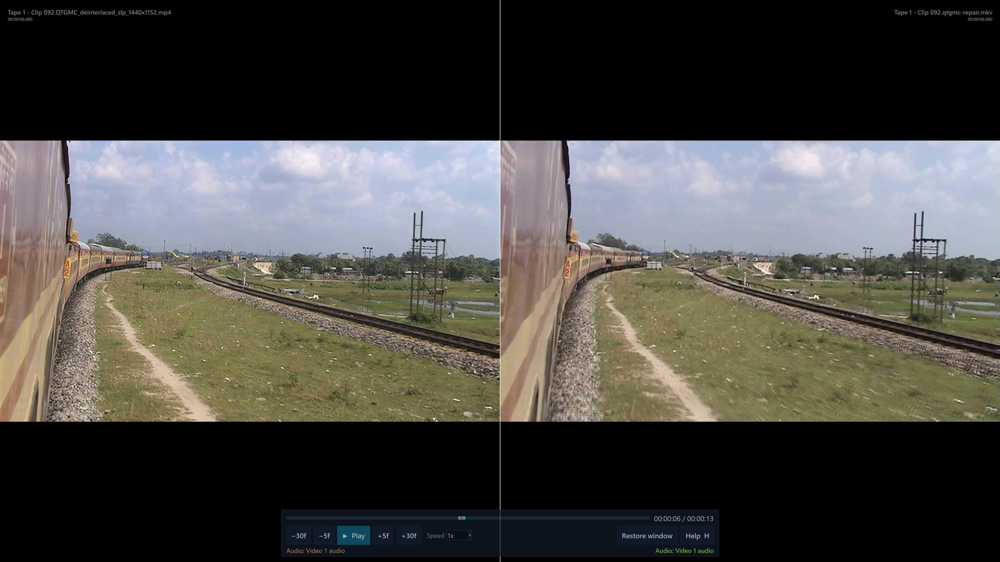
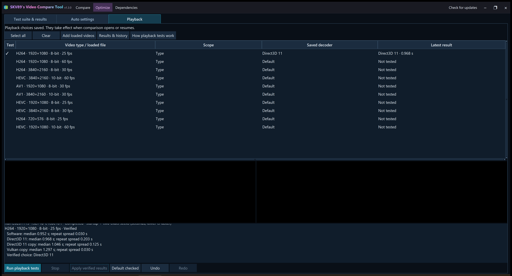
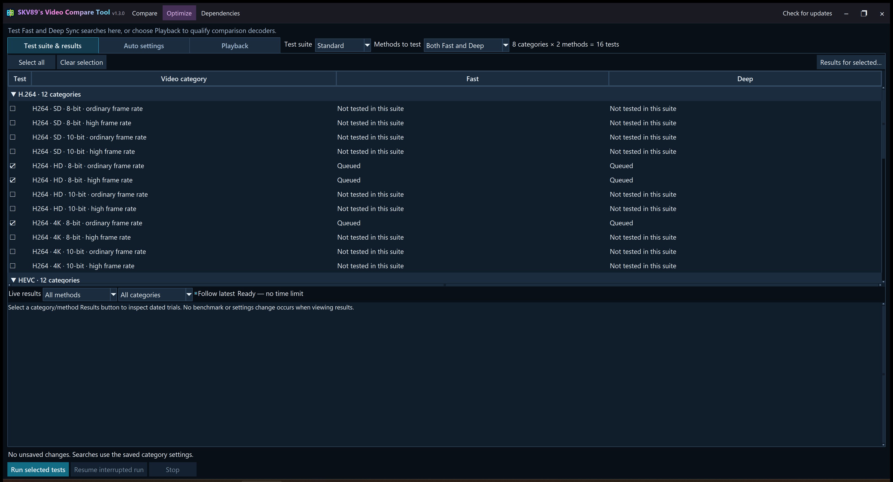
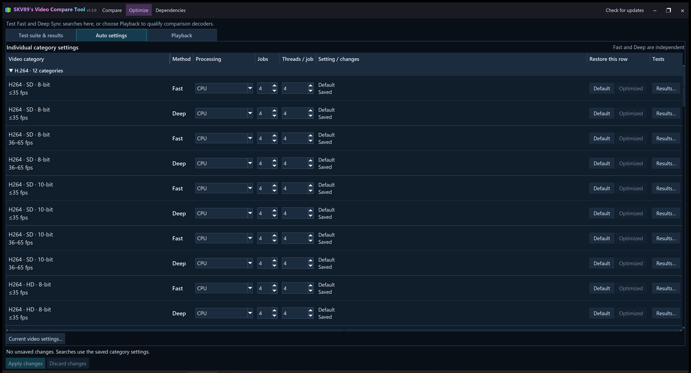
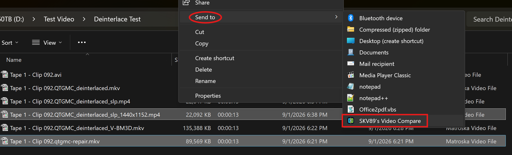

# SKV89's Video Compare Tool v1.3.0

A portable Windows app for comparing two videos, finding corresponding scenes, and saving paired frames.

[Download v1.3.0 for Windows x64](https://github.com/skv89/SKV89s-Video-Compare-Tool/releases/download/v1.3.0/SKV89s-Video-Compare-Tool-v1.3.0-Windows-x64-Portable.zip) · [Release notes](https://github.com/skv89/SKV89s-Video-Compare-Tool/releases/tag/v1.3.0)

**Download size: 701.1 MB, including 477.2 MB of built-in benchmark videos.** Extract the complete ZIP once, then run **SKV89's Video Compare Tool.exe**. 

## New in v1.3.0

- **Playback optimization:** test software, Direct3D 11 and Vulkan-copy decoding, then apply the fastest reliable choice among the tested routes. Use built-in video types or test a loaded file.
- **More responsive large-file navigation:** fewer redundant seeks and improved seeking during Classic dragging. FFV1 and ProRes use software decoding by default; common delivery codecs use compatible Direct3D 11 decoding with software fallback.
- **Compare, Optimize and Dependencies pages:** move between setup, performance settings and bundled-tool checks from the title bar. Compare opens maximized and uses normal window stacking.
- **Picture-scale matching:** a verified scene match can fit the other video's picture to the held video. Use original scale and native 1:1 remain available.
- **Sync and help improvements:** clearer option descriptions, hover help for Sync and soundtrack controls, improved soundtrack-track selection and reuse of recent audio analysis, and more reliable startup/Resume and sync-history handling.
- **Windows compatibility fix:** corrected a bundled multimedia-library failure when reading certain file-association registry strings.

## Start comparing

1. Extract the full ZIP to a writable folder and run the EXE. Keep `_internal`, `tools` and `licenses` together with it.
2. Browse or drop in two videos, choose a mode, then select **Compare full screen**. Classic Video Compare is the first-run default; your saved choice is remembered.
3. Press **Backspace** or **M** to return to setup. **Resume full screen** restores the comparison position and view.

For everyday use, add the optional **SendTo** or **right-click** command. Select exactly two videos in Explorer to open them directly in the app.

## Four comparison modes

### Overlay / Hold

See Video 1; hold the left mouse button to see Video 2, then release to switch back. This helps reveal changes in faces, texture, grain and edges. Tab changes the persistent visible source.

| Video 1 | Video 2 while holding the left button |
| --- | --- |
|  |  |

### Movable Wipe

Move the cursor horizontally to position the dividing line. The line stops following the cursor over the bottom controls so you can use the timeline. Tab swaps sides.

### Classic Video Compare

The cursor controls the reveal line without a bottom transport panel. Click across the picture to seek by that percentage of the common timeline. **Hold the left mouse button and drag left/right to scan both aligned videos together.** Playback pauses during the drag and returns to its previous state on release. The bottom-right timestamp previews the position under the cursor. Tab swaps sides. This interaction is inspired by [pixop/video-compare](https://github.com/pixop/video-compare).

### Side by Side

Show both complete pictures in separate panels to compare overall presentation and motion. Tab swaps the panels.

All modes show filenames and decoded source-frame timestamps. Use the wheel to zoom, right-drag to pan, and middle-click to fit. **Match picture scale** uses the held video's aspect and picture scale when a verified match supports it; **Use original scale** restores each source's own proportions. Native 1:1 suspends scale matching.

## Align corresponding scenes

Press **Enter** to find the current reference scene in the other video. **Y** opens Sync mode, where each video has independent frame controls, a timeline and time entry. Choose which video stays **Fixed**.

- **Fast:** a quicker matching attempt.
- **Deep:** a broader search with detailed neighboring-frame verification.
- **Fast then Deep if needed:** tries Deep when Fast cannot establish a reliable match.

Choose **±30 seconds, ±1, ±2, ±5 or ±10 minutes**, or **Whole video**. The range is centered on the other video's current position. A ±2-minute search covers up to four minutes, clipped at the ends. Strong nearby evidence can finish early; uncertain results require more of the selected range.

**Use soundtrack** adds an audio clue when the files share usable audio. The app considers track roles and checks visual evidence before accepting alignment. Alternate dubs, music changes, silence and commentary can make audio unhelpful; leave the option off when the soundtracks differ.

**Maintain synchronization during playback** enables drift correction under the current alignment. Leave it off for motion comparisons without ongoing catch-up speed changes or corrective seeks. It does not detect advertisements or missing scenes. After a different intro or inserted scene, move to shared footage and search again.

Use **8 / 9** to move only Video 1 and **5 / 6** for Video 2. Tap for a source frame; hold to scan faster. **Ctrl+Z / Ctrl+Y** undo and redo sync adjustments.

**Picture area…** can exclude confidently detected static decorative panels from matching. Full frame and Custom provide overrides. The analysis rectangle does not crop playback, saved frames or the source file.

Scene matching can remain inconclusive or choose a neighboring frame in difficult footage. Check the displayed frames before relying on an alignment. A local match does not reconstruct every edit in a whole episode.

## Optimize playback for this computer

Open **Optimize → Playback**. Check built-in types, or use **Add loaded videos** for file-specific tests. Run the checked rows, review the results, then choose **Apply verified results**. Saved choices take effect when comparison opens or resumes. Keep this tab visible during testing and close other heavy applications for more representative measurements.

The suite tests **Software, Direct3D 11, Direct3D 11 copy and Vulkan copy** with two simultaneous normal-speed previews. Each route must actually use the requested decoder, match software-reference pictures and timestamps, and sustain playback without reported dropped frames. Three repeated trials and a separate confirmation precede a recommendation. The score combines player startup and two exact seeks; lower is faster. Near ties retain a qualified default.

Built-in recommendations match the tested codec, profile, dimensions, pixel format, frame rate and color/display metadata. Loaded-file recommendations apply only to the unchanged tested file. Unsupported, failed and silently falling-back routes cannot win. Untested formats retain their defaults. MP4, MKV and MOV are containers; the codec and pixel format inside determine decoder support.

Vulkan remains eligible when it performs better. Vulkan copy transfers decoded frames through system memory while keeping the Direct3D 11 display renderer; that transfer cost is included. Playback choices are separate from Fast/Deep search settings.

**Stop** preserves saved choices. **Default checked** removes only the checked playback choices; **Undo / Redo** can restore them. Completed results remain in **Results & history**. Playback tests stop at a measured GPU core temperature of 91°C, lost required thermal readings, insufficient memory reserve or an unresponsive phase. Interrupted trials do not become recommendations.

These short tests cannot guarantee every frame or full-episode endurance. Some demanding FFV1 tests can briefly delay the Optimize interface; a responsive comparison window and a zero-drop test do not guarantee that every optimization phase will remain equally responsive.

## Optimize Fast and Deep searches

The separate **Test suite & results** tab measures scene-search configurations. **Standard** selects eight common H.264, HEVC and AV1 categories; **Extended** selects all 36 SD/HD/4K, 8/10-bit and frame-rate categories. Both methods are selected by default: 16 cases for Standard or 72 for Extended. Choose one method or a Custom subset when needed.

Live results appear as measurements finish. **Results…** shows configurations, repeats, timings and explanations. **Stop** preserves search progress; **Resume interrupted run** continues a compatible interrupted search queue. Larger suites can take hours. Search resume and playback qualification have separate histories.

The search suite varies CPU jobs and decoder threads separately, up to a total budget of 32 decoder threads where hardware, work and memory allow. Repeated searches and independent scenes verify contenders. Recommendations describe the best verified settings among those tested.

Review and edit each category's Fast and Deep rows in **Auto settings**, then **Apply changes**. Explicit Manual and Default choices are preserved when applying search recommendations. All scene searches use these rows; there is no separate global numeric worker override.

Type **Jobs** and **Threads / job**, or use the arrows. **Default** restores built-in limits; **Optimized** restores a compatible measured recommendation. Untuned CPUs with 16+ logical processors start at up to four jobs with four decoder threads per job, 8–15 use up to two jobs with four threads, and smaller CPUs use lower limits. These are limits, not reserved cores; more is not always faster.

Compatible NVIDIA H.264 and HEVC rows offer optional **GPU + CPU** scene discovery with independent CPU verification. AV1, interlaced sources and unsupported layouts use CPU in this search backend. A CPU-only reference does not disable a supported GPU target. The chosen Fixed frame stays fixed, and **Current video settings…** explains each file's role. Explicit corruption or unresolved terminal decode status stops matching; these checks do not guarantee detection of every damaged file. GPU search recommendations require a measured benefit. Playback hardware decoding is separate.

## Bundled tools and updates

**Dependencies** verifies FFmpeg, FFprobe, mpv and optional NVIDIA support. It can restore missing or damaged files from a matching package ZIP, or use the supported online restoration when the required release is available. It does not install a graphics driver. **Check for updates** queries this project's published GitHub releases when requested.

## Paired screenshots

Press **P** or **Print Screen** to save two clean JPG frames to the app's `screenshots` folder. Names share one timestamp followed by each source filename. A brief **Screenshots saved** message confirms success. After returning to Compare, capture uses the preserved Resume position. **Q** saves a PNG of the complete comparison view.

## Explorer integration

Select **Add to SendTo menu** or **Add to Context menu** in the app. Select exactly two videos in Explorer, then choose **Send to → SKV89's Video Compare** or **Compare with SKV89's Video Compare Tool**. Windows 11 may place the classic command under **Show more options**. Both integrations are per-user and removable. After moving the portable folder, remove and add them again to update their paths.

## Essential controls

| Input | Action |
| --- | --- |
| Space / K | Play or pause both videos |
| Enter | Find the current reference scene; press again to cancel |
| Y | Show or hide independent Sync controls |
| Ctrl+Z / Ctrl+Y | Undo / redo a sync adjustment |
| A / D | Step both backward / forward; hold to scan |
| 8 / 9; 5 / 6 | Step only Video 1; step only Video 2 |
| Left / Right | Seek backward / forward one second |
| Up / Down | Seek forward / backward 15 seconds |
| Wheel / right-drag / middle-click | Zoom / pan / fit |
| 1 / 2 | Fit / native 1:1 pixels |
| − / + or = | Change playback speed from 0.25× through 4× |
| Left Shift | Tap by itself to cycle audio |
| P / Print Screen; Q | Save paired JPGs; save the full comparison PNG |
| H | Show or hide the scrollable help overlay |
| Backspace / M | Return to Compare, preserving position and view |
| 4 / F11 | Adjustable comparison window / toggle full screen |
| Esc | Exit |

Point to a highlighted Method option for its immediate description. Supported controls offer hover/focus help, and F1 opens detailed choice guidance. Normal text-editing shortcuts remain local to the focused entry.

## Compare restoration models and settings

Export the same scene with Topaz Iris, Rhea, Proteus, Artemis or Gaia, then compare the outputs. Check several faces, lighting conditions and moving scenes for texture, compression, unstable details and excessive smoothing. Overlay, Wipe and Side by Side serve different inspection needs; no model or setting is best for every source. This independent project is not affiliated with or endorsed by Topaz Labs.

## Requirements and upgrading

Windows x64, a writable portable folder, and enough decoding capacity for two videos at once. GPU acceleration is optional. The executable is unsigned, so Windows may display a reputation warning. The package includes FFmpeg/FFprobe, mpv, Python/native runtimes, optional NVIDIA support, and licensed Big Buck Bunny benchmark excerpts.

Use the **complete v1.3.0 portable ZIP** for a public-release upgrade. Close the app, extract into a new folder and keep the old folder as a backup. General preferences remain under `%LOCALAPPDATA%\SKV89 Video Compare Tool`; portable optimization data/history and captures live under `Data` and `screenshots`. Copy those folders into the new location if needed, preserving their originals. Only compatible measured recommendations become active; historical results remain readable. A driver-version change alone does not require rerunning Optimize.

The app does not modify or upload source videos. Optimization generates samples and logs locally. The README inside the download explains storage and upgrade details. Verify the ZIP with **SHA256SUMS.txt** from the release.

Third-party licenses, matching sources and build records

Read the package's `THIRD_PARTY_NOTICES.md` and `licenses` folder. Exact matching dependency sources and build records are indexed [here](https://github.com/skv89/SKV89s-Video-Compare-Tool/blob/v1.3.0/third-party/v1.3.0/README.md). Separate FFmpeg/mpv programs use GPL-covered components, and replaceable FFmpeg libraries use LGPL-covered components. Their original notices and license options remain included. These source materials are for developers and are not needed to run the app.

